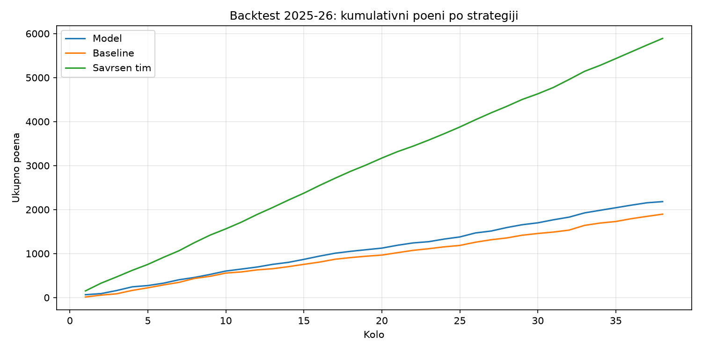
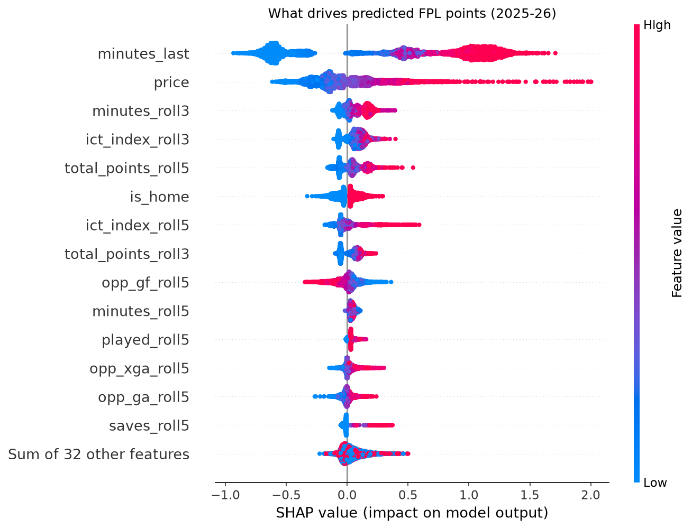
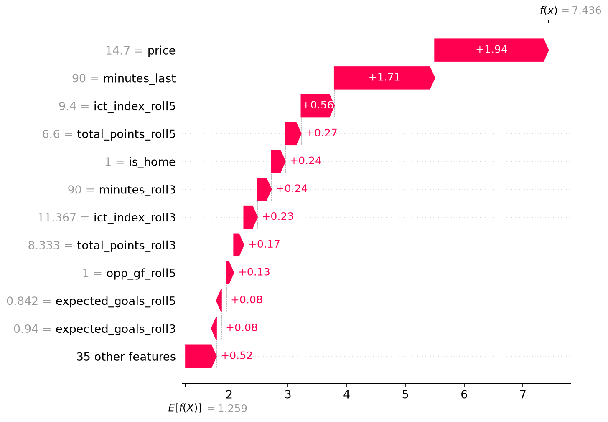

# FPL Predictor

**Live demo:** https://fpl-predictor-straledev.streamlit.app

Predicts Fantasy Premier League points for every player in the upcoming gameweek
and picks the optimal 15-man squad with integer programming.



## Results

Evaluated on the **2025-26 season**, which was never used for training or tuning.

| Metric | Baseline (last 5 matches) | LightGBM |
| --- | --- | --- |
| MAE (points per player-match) | 1.057 | **0.984** |
| Spearman correlation per gameweek | 0.705 | **0.713** |
| Backtest points, 38 gameweeks | 1,898 | **2,230** |

The model-driven squad scored **17.5% more points** than the same optimizer fed
with the baseline. A squad picked with perfect hindsight scores 5,890, an upper
bound that shows how much of FPL is irreducible luck.

**Backtest setup:** every gameweek the optimizer picks a fresh squad within
£100.0m from the model's predictions, and the squad is scored with the players'
actual points (starting XI plus double points for the captain).

## How it works

```
FPL API + historical CSVs → data collection → features → LightGBM → squad optimizer → backtest
```

1. **Data** (`src/data`): 10 seasons (2016-17 to 2025-26, ~254k player-match rows)
   from [vaastav/Fantasy-Premier-League](https://github.com/vaastav/Fantasy-Premier-League),
   plus the official FPL API for the current season.
2. **Features** (`src/features`): 46 features, all computed only from matches
   *before* the one being predicted: rolling player form (points, minutes, xG, xA,
   ICT, bonus), team and opponent attacking/defensive form, home/away, price,
   position and days since the last match. Players are linked across seasons via
   FPL's stable `code`, so form carries over into the first gameweeks of a season.
3. **Model** (`src/models`): LightGBM regressor trained on squared error, because
   the optimizer needs *expected* points, not the median.
4. **Optimizer** (`src/optimize`): binary integer program in PuLP: maximize expected
   points subject to budget, 2-5-5-3 squad, max 3 players per club, valid formation
   and one captain.
5. **Live predictions**: for the current season, predictions are scaled by FPL's
   `chance_of_playing_next_round` to account for injuries and suspensions.
6. **Dashboard** (`app`): Streamlit app with weekly predictions, the optimal squad
   for any budget and the backtest results.

## Key findings

- **57% of player-match rows have zero minutes.** Predicting who plays matters
  more than predicting how well they play.
- **Data leakage caught twice.** The historical `xP` column (FPL's own expected
  points) turned out to be scraped *after* each gameweek ended, so it looked like an
  unbeatable benchmark. The final match score also slipped into the feature list
  at one point. Both are now guarded by tests in `tests/`.
- **Opponent strength changes expected points by 30-70%**, and home teams score
  0.3-0.5 points more per player on average.
- **Linking players across seasons** improved the backtest by 49 points, while the
  overall MAE stayed the same: the gain is concentrated in the opening gameweeks.

## What the model learned (SHAP)



- **Minutes in the previous match is by far the strongest driver** (mean impact
  0.79 points), more than 3x player price (0.23). It works like a switch: a player
  who missed the last match loses about 0.6 points, a player who played 90 minutes
  gains 1.0-1.7. The model is first and foremost a "will he play?" model.
- **Price has a long tail:** for most players it barely moves the prediction, but
  for premium players it is the single largest contribution (up to +2 points; +1.94
  for Haaland in the waterfall below). LightGBM's split-count importance ranked it
  first; SHAP shows the average effect is 0.23 points, concentrated at the top.
- Recent form and opponent strength each add around 0.1 points; home advantage 0.08.
- **Example of the main limitation:** Haaland in GW36 of 2025-26 had the highest
  prediction in the sample (7.44 points) and scored 0. Historical data contains no
  pre-match injury or rotation news, so the model cannot see absences coming.



## Limitations

- The backtest picks a new squad every gameweek (like a Free Hit each week): no
  transfer limits, no hits and no automatic substitutions.
- Historical data has no injury news, so the model cannot learn availability; this
  is only corrected in live predictions.
- Price changes slowly, so the model may react late when a premium player's form drops.
- 2025-26 introduced points for defensive contributions, which the training data
  does not contain.

## Run it

```bash
pip install -r requirements.txt

python -m src.data.fetch_history         # historical seasons
python -m src.data.combine
python -m src.features.build_features
python -m pytest
python -m src.models.train
python -m src.backtest.run_backtest
python -m src.models.explain             # SHAP plots

python -m src.data.fetch                 # current season from the FPL API
python -m src.models.predict             # predictions for the next gameweek
python -m src.optimize.squad             # optimal squad

streamlit run app/streamlit_app.py       # dashboard
```

## Project structure

```
app/             Streamlit dashboard
src/
├── data/        fetching and combining raw data
├── features/    feature engineering
├── models/      training, live predictions and SHAP explanations
├── optimize/    squad optimizer (PuLP)
└── backtest/    season simulation
notebooks/       exploratory data analysis
tests/           leakage tests
reports/